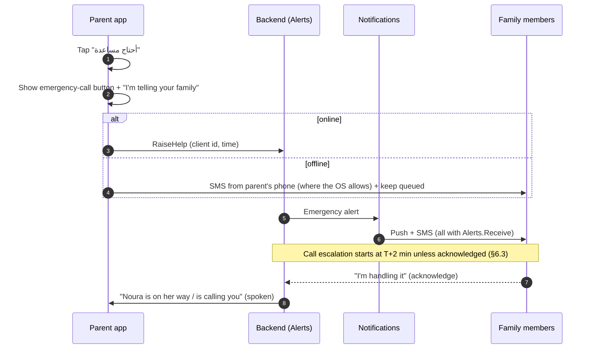
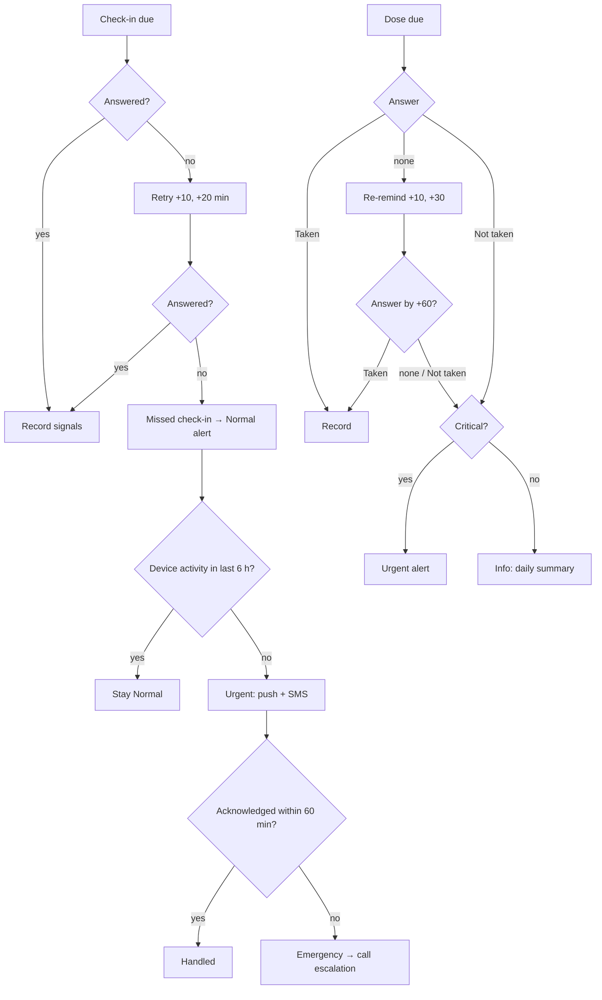

# Rafeeq (رفيق) — Software Requirements Specification

| | |
|---|---|
| Version | 0.1 (draft for owner review) |
| Date | 2026-10-11 |
| Scope | MVP (pilot, Saudi Arabia) and roadmap |
| Related | `CLAUDE.md` (hard rules), `docs/safety.md` (step 3), `docs/brand/` (step 4), `docs/architecture.md` (step 5) |

Requirement ids: `FR-{AREA}-{NN}` functional, `AI-{NN}` AI, `PRV-{NN}` privacy, `NFR-{NN}` non-functional. **Must** = MVP, **Should** = MVP if time allows, **Later** = roadmap.

---

## 1. Vision and scope

### 1.1 Problem
Many elderly people in Saudi Arabia and the GCC live alone, with a spouse, or with a domestic worker, while their children work in other cities. Families worry about medications, appointments, loneliness, and "what if something happens and nobody knows". Coordination happens in WhatsApp groups and phone calls, with no shared picture of the day.

### 1.2 Product
Rafeeq is two things in one app:
1. **A companion for the elderly person.** It speaks their Arabic, checks in on them daily, reminds them of medications and appointments, and gives them one big button for help.
2. **A care-coordination tool for the family and caregivers.** A daily summary, missed medications, mood and activity trends, instant alerts when something is wrong, and a shared care plan, task list and notes.

### 1.3 What Rafeeq is not
- **Not a medical device.** It does not diagnose, monitor a condition, interpret symptoms, or give or change medication. It repeats the care plan the family entered and says "please ask your doctor" to medical questions.
- **Not an emergency service.** It tells the family fast and makes calling the emergency number one tap away. It never promises a response time from anyone.
- **Not surveillance.** No location tracking, no hidden recording, no reading of the parent's other apps. The elderly person sees everything that is shared about them.

### 1.4 Success measures (pilot)
- ≥ 95% of scheduled reminders confirmed or marked by the parent or caregiver within 60 min.
- 100% of emergency alerts reach at least one family member by push or SMS within 1 min (measured end to end).
- ≥ 70% of parents complete at least one check-in on ≥ 5 days a week after 4 weeks.
- Families report less worry (survey at weeks 0 and 8).

---

## 2. Personas

### 2.1 Elderly parent — "Abu Mohammed" (أبو محمد), 78, Riyadh
Lives with his wife and a domestic worker. Type 2 diabetes, high blood pressure, 6 medications a day. Reads Arabic slowly with glasses; prefers talking. Has an Android phone his son set up; uses WhatsApp voice notes and calls. Speaks Najdi Arabic. Does not want to "be a burden" and dislikes being treated like a child.
**Needs:** reminders he can answer by voice, someone to talk to in the afternoon, a sure way to get help, dignity.

### 2.2 Primary family member — "Noura" (نورة), 46, Jeddah
Eldest daughter, works full time, manages her father's medications and appointments by phone. Coordinates three siblings and the domestic worker.
**Needs:** know he took the critical medications, know immediately if something is wrong, one place to manage the plan, fewer phone calls asking "did you take it?".

### 2.3 Other relatives — "Khalid" (خالد), 40, Dammam, and grandchildren
Want to stay informed and be reachable in an emergency, without managing anything.
**Needs:** a short daily summary, emergency alerts, no noise.

### 2.4 Caregiver — "Maria", domestic worker, and "Nurse Huda" (هدى), home-care nurse
Maria lives in the house, speaks basic Arabic and English. Nurse Huda visits twice a week from a home-care company.
**Needs:** see today's tasks and medications, confirm doses given, leave notes, be told what the family expects. Must not see more than their job needs.

### 2.5 Care-company coordinator (Later) — "Faisal" (فيصل)
Manages 120 elderly clients and 30 nurses for a home-care company.
**Needs:** a web dashboard across clients, alerts triage, visit planning. Out of MVP scope.

---

## 3. Roles and permissions

### 3.1 Concepts
- **Family circle:** exactly one elderly person plus everyone connected to them. Two parents living together have two circles; the same relatives can be members of both. (Decision D-01.)
- **Member:** a user in a circle with one role and a set of **grants**. A user can be in several circles with different roles.
- **Grant:** a permission given to a member in one circle. Roles come with default grants (§3.3); the primary family member adjusts them; the elderly person can see and revoke them.
- **Legal representative:** a person who consents on behalf of an elderly person who cannot consent (e.g. advanced dementia). Recorded with a declaration (§7.2).

### 3.2 Roles

| Role | Who | Mode |
|---|---|---|
| `ElderlyPerson` | The person cared for | Parent mode |
| `PrimaryFamilyMember` | One per circle (transferable). Manages the circle and care plan | Family mode |
| `FamilyMember` | Relatives | Family mode |
| `Caregiver` | Domestic worker, home nurse, clinic staff. Optional expiry date | Family mode, limited |
| `CareCompanyAdmin`, `CareCompanyStaff` | Later | Web dashboard |
| `PlatformAdmin` | Rafeeq operations | Admin tools; **no default access to health data** |

### 3.3 Permissions and default grants

✓ = granted by default, ○ = can be granted, — = never.

| Permission | Elderly | Primary | Family | Caregiver |
|---|---|---|---|---|
| `Circle.Manage` (settings, transfer primary) | ○ | ✓ | — | — |
| `Circle.Invite` | ○ | ✓ | ○ | — |
| `Grants.Manage` | ✓ (revoke only) | ✓ | — | — |
| `AccessLog.View` | ✓ | ✓ | — | — |
| `Consent.Manage` | ✓ | — | — | — |
| `CarePlan.View` | ✓ | ✓ | ✓ | ✓ |
| `CarePlan.Edit` (meds, appointments) | ○ | ✓ | ○ | ○ |
| `Medications.Confirm` (on behalf of parent) | ✓ (own) | ✓ | ○ | ✓ |
| `Adherence.View` (taken / missed history) | ✓ | ✓ | ✓ | ○ |
| `CheckIns.ViewSummary` | ✓ | ✓ | ✓ | ○ |
| `CheckIns.ViewTranscript` | ✓ | ○ (needs parent consent) | ○ (needs parent consent) | — |
| `Trends.View` (mood, activity) | ✓ | ✓ | ✓ | — |
| `Alerts.Receive` | — | ✓ | ✓ | ○ |
| `Alerts.ReceiveCalls` (call escalation list) | — | ✓ | ○ | ○ |
| `Alerts.Acknowledge` | — | ✓ | ✓ | ○ |
| `Notes.View` / `Notes.Add` | ✓ | ✓ | ✓ / ○ | ✓ |
| `Tasks.View` / `Tasks.Manage` | ✓ | ✓ | ✓ / ○ | ✓ / ○ |
| `Memory.View` / `Memory.Delete` (AI memory) | ✓ | ✓ | — | — |

Caregiver role templates (presets the primary chooses at invite): **Home nurse** (care plan, confirm meds, notes, tasks, adherence), **Domestic worker** (today's meds and tasks, confirm meds, notes; no history or trends), **Clinic** (care plan and appointments view only).

Rules:
- `FR-PRM-01` **Must.** Every permission check is scoped to one circle. A member of circle A can never read circle B's data.
- `FR-PRM-02` **Must.** Revoking a grant takes effect on the next request (no cached access beyond 60 s).
- `FR-PRM-03` **Must.** The elderly person can revoke any member's access, including the primary. Revoking the primary requires choosing a new primary (or the circle becomes parent-managed); the app explains this by voice.
- `FR-PRM-04` **Must.** `PlatformAdmin` support access to a circle's health data is a time-boxed grant (max 24 h) approved by the elderly person or primary, and is logged.

---

## 4. Functional requirements

### 4.1 Onboarding and accounts (`FR-ONB`)

- `FR-ONB-01` **Must.** Family members sign up with a mobile number and SMS OTP. No passwords.
- `FR-ONB-02` **Must.** The primary creates a circle and the elderly person's profile: name, how to address them (e.g. "يا أبو محمد", "يا والدتي", "حضرتك"), preferred language variety (Saudi/Gulf dialect or MSA), voice (male/female), city and time zone, country (for emergency numbers), emergency contacts order.
- `FR-ONB-03` **Must.** The parent's phone is paired with a QR code or 6-digit code shown in the family app. The parent never types a password. The device stays signed in; re-pairing is done from the family app.
- `FR-ONB-04` **Must.** On first launch in parent mode, Rafeeq introduces itself by voice and asks for consent per purpose (§7.2), in the parent's language, with large "موافق / Agree" and "لا / No" buttons and voice answers.
- `FR-ONB-05` **Must.** If the parent cannot consent, the primary can record a legal representative's consent with a declaration; the circle is marked "consent by representative".
- `FR-ONB-06` **Must.** The setup checklist on the parent's phone guides the family to grant notification, exact-alarm, microphone and battery-optimisation exemptions, and verifies each one (detail in architecture).
- `FR-ONB-07` **Must.** Invitations by phone number (SMS link) with role and grants chosen up front. Invitations expire after 7 days.

### 4.2 Parent experience (`FR-PAR`)

- `FR-PAR-01` **Must.** One home screen: greeting and date (Hijri and Gregorian), the next reminder, a big **"تحدث مع رفيق / Talk to Rafeeq"** button, a big **"أحتاج مساعدة / I need help"** button, and up to 4 large family photos to call directly.
- `FR-PAR-02` **Must.** Every screen in parent mode can be used fully by voice and read aloud. No screen requires reading.
- `FR-PAR-03` **Must.** At most two taps from home to any action. No menus, no settings in parent mode (settings are managed from the family app).
- `FR-PAR-04` **Must.** The emergency call button (local number, per country) is always visible in the help flow and reachable in one tap.
- `FR-PAR-05` **Must.** Text, targets, contrast and motion follow `mobile/CLAUDE.md` §3 and the brand kit (step 4).
- `FR-PAR-06` **Must.** Mistakes are recoverable: an answer can be changed for 2 minutes ("غيّرت رأيي / I changed my mind"), and important answers are confirmed by voice.
- `FR-PAR-07` **Should.** Works on tablets in landscape and portrait.

### 4.3 Care plans and medications (`FR-CPL`) — module `CarePlans`

- `FR-CPL-01` **Must.** A medication has: display name (as on the box, Arabic and/or Latin), optional photo of the box/pill, dose text as written by the family (e.g. "حبة واحدة / one tablet"), schedule, instructions text (e.g. "بعد الأكل / after food"), **critical** flag, start and optional end date.
- `FR-CPL-02` **Must.** Schedules: fixed times, every N hours, specific weekdays, **relative to a prayer** ("بعد صلاة العشاء / after Isha", with an offset), as needed (no reminder; logged only when taken).
- `FR-CPL-03` **Must.** Prayer times are computed for the parent's city using the Umm al-Qura method, recalculated daily, and cached on the device for 30 days.
- `FR-CPL-04` **Must.** Appointments: title, place, date and time, who accompanies, reminder offsets (default: day before at 20:00, 2 h before).
- `FR-CPL-05` **Must.** Every change creates a new care-plan version (who, when, what changed). The family can see the history.
- `FR-CPL-06` **Must.** Rafeeq never computes doses, never suggests timings, and never warns about interactions. Entry forms say: "أدخل الدواء كما وصفه الطبيب / Enter as prescribed by the doctor".
- `FR-CPL-07` **Must.** Care-plan changes reach the parent's phone and reschedule local reminders within 1 minute when online; the parent app shows when the plan was last synced.
- `FR-CPL-08` **Later.** Read a prescription or medicine box from a photo; the family must review and confirm every field.
- `FR-CPL-09` **Later.** Integrations (Sehhaty, Nphies, pharmacy).

### 4.4 Reminders and confirmations (`FR-REM`) — modules `CarePlans`, `CheckIns`, mobile

- `FR-REM-01` **Must.** Reminders fire on the parent's device at the scheduled local time **without network**, from the locally stored plan.
- `FR-REM-02` **Must.** A reminder speaks: who it is for, the medication name, dose and instructions exactly as in the care plan, and shows the medication photo. Example [SA]: "يا أبو محمد، حان وقت دواء الضغط، حبة واحدة بعد الأكل. هل أخذته؟"
- `FR-REM-03` **Must.** The parent answers **"أخذته / Taken"** or **"لم آخذه / Not taken"** by voice or button. "Later" (بعدين) re-reminds in 10 min.
- `FR-REM-04` **Must.** No answer: re-remind at +10 and +30 min; at +60 min the dose is **Missed**.
- `FR-REM-05` **Must.** Missed or "not taken" on a **critical** medication raises an **Urgent** alert (§6). On a non-critical medication it appears in the daily summary only.
- `FR-REM-06` **Must.** Rafeeq never says to take a missed dose later, double a dose, or skip one. After "not taken" it says: "حسناً، سأبلغ العائلة / Okay, I'll let the family know" (critical) or records it (non-critical).
- `FR-REM-07` **Must.** A caregiver with `Medications.Confirm` can confirm a dose. Every confirmation records who confirmed, how (voice, button, caregiver), device time and server time.
- `FR-REM-08` **Must.** Multiple medications due at the same time are grouped into one reminder, listed one by one, with an answer per medication.
- `FR-REM-09` **Must.** If the device was off when a reminder was due, on start-up the app shows the missed reminders as missed (never as "take now") and syncs.
- `FR-REM-10` **Must.** Appointment reminders with "I know / حسناً" acknowledgement; no escalation.

### 4.5 Check-ins (`FR-CHK`) — module `CheckIns`

- `FR-CHK-01` **Must.** Scheduled voice check-ins, default 09:00 and 20:00 parent local time, configurable (1–4 per day).
- `FR-CHK-02` **Must.** Questions come from a library the primary chooses from: sleep, mood, morning medications done, eaten, went out/walked, anything you need, anything worrying you. No clinical questionnaires.
- `FR-CHK-03` **Must.** The check-in is a short conversation led by the AI companion (§5); answers are stored as structured signals (sleep: good/okay/poor, mood: good/okay/low, needs) plus the transcript (§7.4).
- `FR-CHK-04` **Must.** If the AI service is unavailable, the app runs the same check-in as a scripted, pre-recorded flow with button answers. A check-in never fails because AI is down.
- `FR-CHK-05` **Must.** No answer: retry at +10 and +20 min. Then **Missed check-in** → Normal alert. If the device has also shown no activity (no unlock, no app interaction, no answered reminder) for 6 h → Urgent. Urgent unacknowledged for 60 min → Emergency call escalation (§6.3).
- `FR-CHK-06` **Must.** The parent can start a conversation any time with "Talk to Rafeeq". Rafeeq does not start conversations outside scheduled check-ins and reminders.

### 4.6 Alerts and escalation (`FR-ALR`) — module `Alerts`

- `FR-ALR-01` **Must.** Severities: **Emergency**, **Urgent**, **Normal**, **Info** (§6.1).
- `FR-ALR-02` **Must.** Triggers are rules only: help button, emergency phrase list hit, missed check-in rules, missed critical medication, device-silent rules, low battery. The AI may add a **Normal** "worth a look" flag; it can never create, cancel, delay or downgrade an Emergency or Urgent alert.
- `FR-ALR-03` **Must.** Emergency: push + SMS to all members with `Alerts.Receive` immediately, then call escalation (§6.3).
- `FR-ALR-04` **Must.** Any recipient can acknowledge with **"أنا أتابع الحالة / I'm handling it"**. Acknowledgement stops call escalation and shows everyone who is handling it. The handler later resolves the alert with an outcome (resolved, false alarm, went to hospital, other + note).
- `FR-ALR-05` **Must.** Alerts are idempotent: the same trigger within its dedup window updates the open alert instead of creating a new one.
- `FR-ALR-06` **Must.** Emergency and Urgent ignore quiet hours and Do-Not-Disturb where the platform allows (critical alerts on iOS require Apple's entitlement — see roadmap/risks).
- `FR-ALR-07` **Must.** Family members see an alert timeline: trigger, every notification sent and delivered, calls made and answered, acknowledgement, resolution.
- `FR-ALR-08` **Must.** Emergency numbers per country in config (`CLAUDE.md` §5), synced to the device.
- `FR-ALR-09` **Must.** Rafeeq never calls the emergency number itself (D-05). The family app's alert screen has a "call emergency services" button and the parent's address and profile summary ready to read out.

### 4.7 Notifications (`FR-NTF`) — module `Notifications`

- `FR-NTF-01` **Must.** Channels: push (FCM/APNs), SMS, automated voice call (text-to-speech in Arabic, with "press 1 to acknowledge").
- `FR-NTF-02` **Must.** Message text never contains health details (`CLAUDE.md` §6). Example SMS [MSA]: "رفيق: تنبيه عاجل بخصوص والدك. افتح التطبيق الآن أو اتصل به."
- `FR-NTF-03` **Must.** Delivery status is tracked per message; a failed push for an Emergency triggers SMS regardless.
- `FR-NTF-04` **Must.** Each family member sets quiet hours for Normal and Info only.
- `FR-NTF-05` **Must.** Daily summary push at a time each member chooses (default 21:00): "ملخص يوم والدك جاهز / Your father's daily summary is ready".
- `FR-NTF-06` **Must.** SMS and voice providers behind interfaces with a fallback provider (vendor choice by ADR).

### 4.8 Family experience (`FR-FAM`) — family mode

- `FR-FAM-01` **Must.** Today screen per circle: check-ins done/missed, medications taken/missed/pending, open alerts, next appointment, mood today, last activity time, phone battery and last sync.
- `FR-FAM-02` **Must.** Daily summary: plain-language summary of the day generated from structured data and check-in signals, with flagged phrases. No clinical wording, no scores (§5).
- `FR-FAM-03` **Must.** Trends for 7 and 30 days: medication adherence, check-in completion, mood, sleep, activity. Shown as facts ("نام جيداً 5 من 7 أيام / slept well 5 of 7 days"), never as health risk.
- `FR-FAM-04` **Must.** Care plan management (for members with `CarePlan.Edit`).
- `FR-FAM-05` **Must.** Circle screen: members, roles, grants, invitations, caregiver expiry.
- `FR-FAM-06` **Must.** Switch between circles (e.g. mother and father).
- `FR-FAM-07` **Must.** Shared notes (with author and time) and a task list (assign to a member or caregiver, due date, done).

### 4.9 Caregivers (`FR-CGV`) — module `Caregivers`

- `FR-CGV-01` **Must.** Invite by phone with a role template (§3.3), optional expiry date, and optional inclusion in alert lists.
- `FR-CGV-02` **Must.** Caregiver home: today's medications to give/confirm, today's tasks, notes, how to reach the primary.
- `FR-CGV-03` **Must.** Caregiver UI languages: Arabic and English in MVP (D-09). Urdu, Tagalog, Indonesian **Later**.
- `FR-CGV-04` **Must.** Shift notes ("visited at 10:00, father in good spirits") visible to members with `Notes.View`.
- `FR-CGV-05` **Must.** Removing a caregiver revokes access immediately and signs out their session for that circle.

### 4.10 AI companion (`FR-AIC`) — see §5 for rules

- `FR-AIC-01` **Must.** Voice conversation in Saudi/Gulf Arabic or MSA, as configured, and English.
- `FR-AIC-02` **Must.** Answers "what medicine now?", "when is my appointment?", "who is coming today?" by reading the care plan, tasks and notes.
- `FR-AIC-03` **Must.** Remembers what the parent chooses to share (family names, interests, routines) and uses it in later conversations. The parent and primary can see and delete these memories.
- `FR-AIC-04` **Must.** Can call family: "اتصل بنورة / call Noura" opens the phone call after a voice confirmation.
- `FR-AIC-05` **Should.** Light companionship content: talk about the day, family news the family posts as notes, general topics. No religious rulings (fatwa), politics or financial advice; Quran recitation and adhkar playback **Later** (from licensed sources).

---

## 5. AI requirements and safety rules

The full refusal / handover / alert catalogue with test cases is `docs/safety.md` (step 3). This section sets the requirements.

### 5.1 Pipeline (every turn)
`AI-01` **Must.** Order, per `ai-service/CLAUDE.md`: (1) deterministic emergency detector on the raw transcript, (2) content filter and prompt shields, (3) medical-intent classifier, (4) companion model grounded on the care plan, (5) output check against the care plan, then text-to-speech.

### 5.2 Rules

| Id | Requirement |
|---|---|
| `AI-02` | Emergency phrases (fall, chest pain, can't breathe, stroke signs, heavy bleeding, unconscious person, self-harm intent) trigger the Emergency alert **before** any model call, and get a fixed reply: "سأبلغ عائلتك الآن. هل تريد أن أتصل بالإسعاف؟ / I'm telling your family now. Do you want me to call an ambulance?" with the one-tap call. |
| `AI-03` | Never diagnose, interpret a symptom, or say whether something is serious or not. |
| `AI-04` | Never suggest, confirm, change, skip, double or time a dose. Never discuss interactions or side effects. Fixed reply: "هذا سؤال للطبيب. هل تريد أن أبلغ نورة لتتواصل مع الطبيب؟ / That's a question for your doctor. Shall I let Noura know so she can contact the doctor?" |
| `AI-05` | Medication name, dose, time and instructions are repeated **exactly** from the care plan. If the care plan has no answer: "ليست عندي هذه المعلومة في خطتك. سأسأل العائلة. / I don't have that in your plan. I'll ask the family." |
| `AI-06` | Non-emergency worrying signals (dizziness, pain not in the chest, not eating, sadness, loneliness, confusion about time/place) → empathetic reply, no advice, a **Normal** "worth a look" flag to the family. |
| `AI-07` | Tone: formal and warm, addresses the parent as configured, short sentences, one question at a time, patient with repetition. Never childish, never sarcastic, no emoji in text, never claims to be human. If asked: "أنا رفيق، مساعد صوتي يعمل بالذكاء الاصطناعي / I'm Rafeeq, an AI voice assistant." |
| `AI-08` | No religious rulings, political opinions, legal or financial advice; politely redirects to the family or a specialist. |
| `AI-09` | Never asks for or repeats national IDs, bank details, passwords or OTP codes; warns gently if the parent offers them ("لا تشارك هذه المعلومات مع أحد على الهاتف"). Scam-call topics → Normal flag to family. |
| `AI-10` | Mutating actions (call someone, confirm a dose, add a note) require spoken confirmation before execution. |
| `AI-11` | If the model, search or speech is unavailable or slow (> 6 s), use scripted fallbacks; reminders, check-ins and alerts continue without AI. |
| `AI-12` | Memory: stores only what the parent says about themselves and family, never health facts outside the care plan; visible and deletable (`Memory.View/Delete`). |
| `AI-13` | Retrieval is limited to the parent's own circle data and the caller's grants. |
| `AI-14` | Safety evaluations from `docs/safety.md` run in CI with absolute thresholds (100% emergency recall, 100% medical refusal, zero invented medication facts). |
| `AI-15` | Speech: Saudi/Gulf/MSA recognition with a per-person phrase list (family names, medication names); slower, clear neutral voice; rate adjustable. |

---

## 6. Emergency and escalation

### 6.1 Severities

| Severity | Examples | Channels | Escalation | Quiet hours |
|---|---|---|---|---|
| **Emergency** | Help button; emergency phrase; Urgent missed-check-in unacknowledged 60 min | Push + SMS to all alert recipients | Call escalation (§6.3) | Ignored |
| **Urgent** | Missed or "not taken" critical medication; missed check-in + device silent 6 h; device offline (no heartbeat) for 6 h during waking hours | Push + SMS | Re-notify at +30 min if unacknowledged; missed-check-in Urgent → Emergency at +60 min | Ignored |
| **Normal** | Missed check-in; AI "worth a look" flag; battery < 15% | Push | None | Respected |
| **Info** | Non-critical missed dose; daily summary items | Daily summary | None | — |

### 6.2 Help button flow

- `FR-ALR-10` **Must.** After the help button, the parent sees and hears: the family is being told, the emergency-call button, and "أنا بخير، كان خطأ / I'm okay, it was a mistake".
- `FR-ALR-11` **Must.** "I'm okay" does **not** cancel the alert. It notifies everyone that the parent reports being okay and stops further call escalation; the alert stays open until a family member resolves it.
- `FR-ALR-12` **Must.** Emergency phrase detection follows the same flow, plus a spoken "هل أنت بخير؟ / Are you okay?" after the alert is sent.

### 6.3 Call escalation (Emergency)

| Time | Action |
|---|---|
| T+0 | Push + SMS to every member with `Alerts.Receive` |
| T+2 min | If not acknowledged: automated call to the 1st person on the call list (default: primary) |
| every +2 min | Next person on the call list (`Alerts.ReceiveCalls`, ordered in circle settings) |
| list exhausted | Repeat the list once, then re-send push + SMS to everyone marked "nobody has acknowledged" every 10 min until acknowledged |
| any time | Acknowledgement (app, or press 1 on the call) stops calls; "I'm okay" from the parent stops calls (§6.2) |

- `FR-ALR-13` **Must.** Escalation survives server restarts and is driven by the server, not by the parent's phone.
- `FR-ALR-14` **Must.** The parent's phone being off, offline or out of battery never stops escalation once the server has the alert.
- `FR-ALR-15` **Must.** When the parent's phone goes silent (no heartbeat), the server — not the phone — detects it and raises the Urgent "device offline" alert. Details in `docs/architecture.md`.

### 6.4 Missed check-in and missed medication

---

## 7. Privacy and consent (Saudi PDPL)

### 7.1 Principles
- `PRV-01` **Must.** All personal and health data is stored and processed in Saudi Arabia (`CLAUDE.md` §6). No cross-border transfer without a legal assessment and an ADR.
- `PRV-02` **Must.** Health data is treated as sensitive data: encrypted at rest (field level for `[Sensitive]`), in transit TLS 1.2+, never in logs, analytics, crash reports, push or SMS text.
- `PRV-03` **Must.** Data minimisation: no location tracking, no contacts upload, no access to other apps. Microphone only while Rafeeq is listening, with a visible and audible indicator.

### 7.2 Consent
- `PRV-04` **Must.** Consent per purpose, recorded as `ConsentRecord` (subject, purpose, method: tap / voice / representative, text version, time, device, revoked at):

| Purpose | Required for MVP use | Default |
|---|---|---|
| P1 Companion conversations and AI processing of voice | Yes | — |
| P2 Sharing reminders, adherence and alerts with the circle | Yes | — |
| P3 Sharing check-in summaries and trends with family | No | Asked |
| P4 Sharing full transcripts with named family members | No | Off |
| P5 Caregiver access (per caregiver) | No | Asked at invite |
| P6 Contacting family by SMS and automated calls in alerts | Yes | — |
| P7 De-identified product analytics | No | Off |

- `PRV-05` **Must.** Consent is asked in the parent's language, read aloud, in plain words, with a written copy in the app. Refusing an optional purpose never blocks the core features.
- `PRV-06` **Must.** Consent by a legal representative records the representative's identity and declaration. Legal review decides the evidence needed (see §10).
- `PRV-07` **Must.** Consent can be withdrawn at any time from the parent's phone (by voice: "أريد أن أوقف مشاركة ..." leads to a confirmation) or by the representative. Withdrawal of P1/P2/P6 pauses the service and explains the consequence.

### 7.3 Transparency and rights
- `PRV-08` **Must.** "Who can see my information / من يرى معلوماتي": the parent hears and sees each member, what they can see, and when they last viewed it; can revoke.
- `PRV-09` **Must.** Access log: every view of health data by someone other than the parent is recorded and visible to the parent and primary.
- `PRV-10` **Must.** Data-subject rights: access and copy (export), correction, deletion. Requests from the parent, the representative, or via support; fulfilled within the period PDPL sets.
- `PRV-11` **Must.** Privacy notice in Arabic and English, in the app and on the website.
- `PRV-12` **Must.** Breach response plan including notification to the authority (SDAIA) and affected people within the PDPL deadlines.

### 7.4 Retention (defaults, subject to legal review)

| Data | Retention |
|---|---|
| Voice audio | Not stored. Processed in memory and discarded (D-11) |
| Transcripts | 90 days |
| Structured signals, adherence, check-in results | While the circle is active; deleted 30 days after closure |
| Alerts and their timelines | 2 years (safety record), then deleted |
| Consent records and access log | 5 years after the circle closes (evidence), then deleted |
| AI memories | Until deleted by the parent/primary or circle closure |
| Backups | Rolling 35 days |

---

## 8. Non-functional requirements

### 8.1 Reliability of reminders and alerts

| Id | Requirement |
|---|---|
| `NFR-01` | ≥ 99.9% of scheduled reminders fire on the device within 60 s of the scheduled time when the device is on (measured by device telemetry of fire time vs schedule). |
| `NFR-02` | Reminders keep working with no network for at least 30 days (plan and prayer times cached). |
| `NFR-03` | Reminders survive device reboot, app update, time-zone change and app being swiped away. |
| `NFR-04` | Emergency alert: push and SMS dispatched within 10 s (p95) of the server receiving it; first call at T+2 min ± 15 s. |
| `NFR-05` | Help button to server receipt < 5 s p95 on a 3G connection; offline fallback per §6.2. |
| `NFR-06` | Alert pipeline (Alerts, Notifications, providers) availability 99.95% monthly; other services 99.5%. |
| `NFR-07` | Synthetic end-to-end test alert every 5 min in production (to an internal test circle); paging on failure. |
| `NFR-08` | No single provider failure (one SMS vendor, one push service) stops Emergency delivery. |
| `NFR-09` | Escalation state is durable; a deploy or crash mid-escalation resumes within 30 s without duplicate calls. |

### 8.2 Performance
- `NFR-10` Voice turn: first audio of the reply < 3 s p50, < 5 s p95 from the end of the parent's speech.
- `NFR-11` Family app cold start < 3 s on a mid-range Android; today screen data < 2 s p95.
- `NFR-12` Peak load: many reminders fire at the same minutes (after prayers, 08:00, 21:00). Backend handles confirmations from 10 000 circles within the same 5 minutes without delay to alerts (alerts have priority queues).

### 8.3 Accessibility (elderly UX)
- `NFR-13` Parent mode: text contrast ≥ 7:1 (WCAG 2.2 AAA), targets ≥ 72 dp, works at OS text scale 2.0×, works with TalkBack and VoiceOver.
- `NFR-14` Family mode: WCAG 2.2 AA, text scale 1.5×.
- `NFR-15` Every parent-mode action is possible by voice alone.
- `NFR-16` Usability tested with at least 8 elderly users (mixed literacy and dialect) before pilot launch; each blocker fixed.

### 8.4 Data residency and security
- `NFR-17` All services on the data path in an in-Kingdom region (per-service region decided in step 5 / ADR).
- `NFR-18` Hosting meets the applicable Saudi cybersecurity controls for cloud and essential controls (NCA ECC/CCC) — to be confirmed with legal/compliance.
- `NFR-19` OTP login with rate limiting and SIM-swap aware re-verification for sensitive actions (transfer primary, export data).
- `NFR-20` Parent device tokens are device-bound and revocable from the family app.
- `NFR-21` Penetration test before pilot launch.

### 8.5 Platforms and scale
- `NFR-22` Android 10+ and iOS 16+ (to be confirmed against pilot devices). Phones and tablets in parent mode.
- `NFR-23` Pilot: ~100 circles. Year 1: ~10 000 circles, ~50 000 users. Architecture must scale to 100 000 circles without redesign.
- `NFR-24` App size < 60 MB; background battery use within Android/iOS "normal" ranges (no persistent foreground service unless the architecture step justifies it).

### 8.6 Localization
- `NFR-25` Arabic (default) and English everywhere; caregiver languages later (D-09). Hijri and Gregorian dates. Arabic-Indic or Latin digits per user setting.

### 8.7 Observability and operations
- `NFR-26` Metrics per reminder (scheduled, fired, answered), per alert (each step and latency), per AI turn (latency, fallback used, safety decisions). No personal data in telemetry.
- `NFR-27` 24/7 on-call for the alert pipeline from pilot launch.

---

## 9. MVP scope and roadmap

### 9.1 MVP (pilot, Saudi Arabia, ~100 families, free)
- Mobile app: parent mode and family mode (Android + iOS), Arabic and English.
- Onboarding, pairing, consent (including legal representative).
- Care plan: medications (incl. prayer-relative schedules), appointments, versions.
- Offline local reminders with taken / not taken, caregiver confirmation.
- Voice check-ins (AI, with scripted fallback); "Talk to Rafeeq" companion with memory.
- Help button, emergency phrases, missed check-in and critical-medication rules, device-silent detection.
- Alerts: push, SMS, automated calls, acknowledgement, timeline.
- Daily summary, 7/30-day trends, notes, tasks.
- Caregivers with role templates and expiry.
- Privacy: access list, access log, export and deletion requests.
- Backend modules and AI service; no web apps.

### 9.2 Roadmap

| Phase | Content |
|---|---|
| **1 — Launch (KSA)** | Subscriptions (per family; payment method by ADR), caregiver UI in Urdu, Tagalog, Indonesian; Ramadan mode (shift schedules around fasting, entered by the family); prescription photo reading with human review; iOS critical-alert entitlement |
| **2 — GCC + web** | UAE, Kuwait, Qatar, Bahrain, Oman (country config, numbers, SMS sender ids, data residency per country); family web view (`frontend/family-web`) |
| **3 — Care companies** | `care-dashboard`: multi-client view, alert triage, visit scheduling, staff management, B2B billing |
| **4 — Devices and integrations** | Automated phone-call check-ins for parents without a smartphone; smartwatch / sensor fall detection (as a trigger only); Sehhaty / pharmacy integrations; Quran and adhkar playback from licensed sources |

---

## 10. Assumptions, risks and open items

| # | Item | Owner |
|---|---|---|
| R-01 | Regulatory positioning: confirm with SFDA guidance that Rafeeq, as specified, is not Software as a Medical Device. Wording in app and store must stay non-medical. | Legal |
| R-02 | PDPL: health data processing basis, representative consent evidence, retention periods, transcript sharing. | Legal / DPO |
| R-03 | In-Kingdom availability of every cloud service needed (Azure OpenAI, Speech, AI Search, SQL, Redis, messaging). May force alternatives. | Step 5 / ADR |
| R-04 | SMS sender id registration and automated voice calls in KSA (regulatory and vendor). | Ops / ADR |
| R-05 | Android OEM battery savers (Samsung, Xiaomi, Huawei, Oppo) can delay local alarms; iOS limits pending local notifications (64) and Do-Not-Disturb bypass needs the Critical Alerts entitlement. | Step 5 |
| R-06 | Arabic dialect speech recognition accuracy for elderly voices (Najdi, Hijazi, Southern, Gulf). Pilot must measure word error rate on real (consented) samples. | AI |
| R-07 | Emergency numbers (`CLAUDE.md` §5) verified with official sources. | Ops |
| R-08 | Firebase (push/analytics/crash) and data residency. | Step 5 / ADR |
| R-09 | Accidental help-button presses (shaky hands) causing alert fatigue; measured in pilot, mitigated by "I'm okay" and family feedback, never by delaying the alert. | Product |

---

## 11. Decision log (owner answers, 2026-10-11)

| Id | Decision |
|---|---|
| D-01 | One elderly person per circle; two parents = two circles sharing members. |
| D-02 | Family sets up the parent's phone; the parent consents in parent mode; legal representative supported in MVP. |
| D-03 | Parent uses own smartphone or tablet; phone-call check-ins later. |
| D-04 | Parent mode must work without reading. |
| D-05 | Emergency: push + SMS at once, call escalation from T+2 min; Rafeeq never calls emergency services itself. |
| D-06 | Missed check-in: 2 retries 10 min apart → Normal; + 6 h device silence → Urgent; Urgent unacknowledged 60 min → Emergency. |
| D-07 | Medication: re-remind +10, +30; missed at +60; critical → Urgent alert, non-critical → summary. Caregivers can confirm; source recorded. |
| D-08 | Care plan entered manually by primary or permitted caregiver; photo reading and integrations later. |
| D-09 | Caregiver UI in Arabic and English for MVP; Urdu, Tagalog, Indonesian later. |
| D-10 | MVP falls = help button, phrases, no response; sensors and wearables later. |
| D-11 | Family sees summaries and flagged phrases, not transcripts, unless the parent consents; audio not stored; transcripts 90 days. |
| D-12 | Prayer-relative reminders in MVP; Ramadan mode later. |
| D-13 | Parent chooses male/female voice; Rafeeq speaks only at check-ins, reminders, and when spoken to. |
| D-14 | Launch in KSA only; GCC ready in config. |
| D-15 | No payments in MVP (free pilot); pricing later. |
| D-16 | Pilot ~100 families; ~10 000 circles in year 1. |
| D-17 | Care-company staff use family mode as caregivers in MVP; web dashboard later. |
